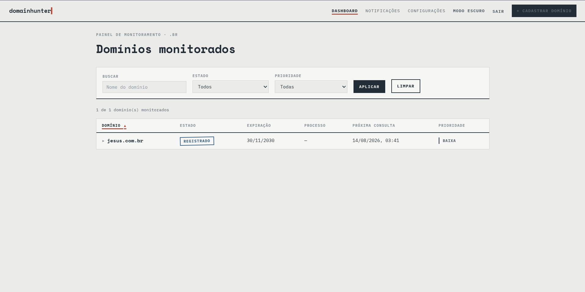
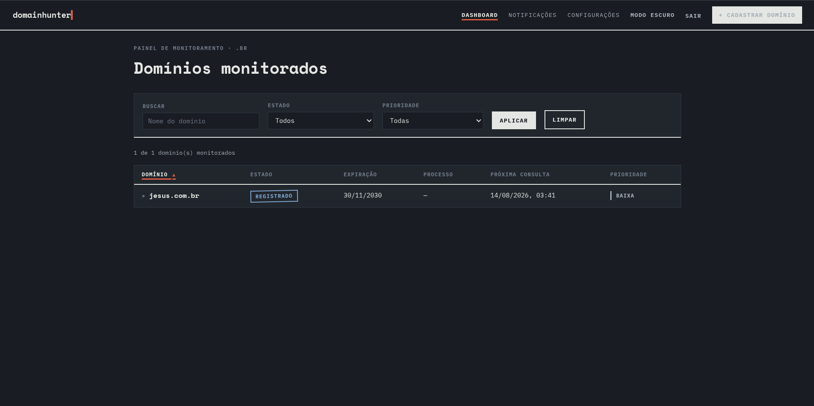
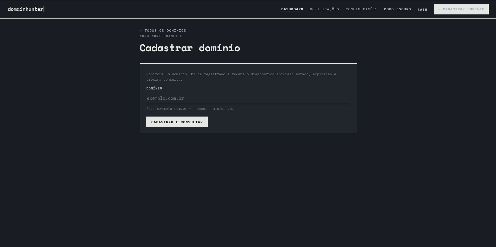
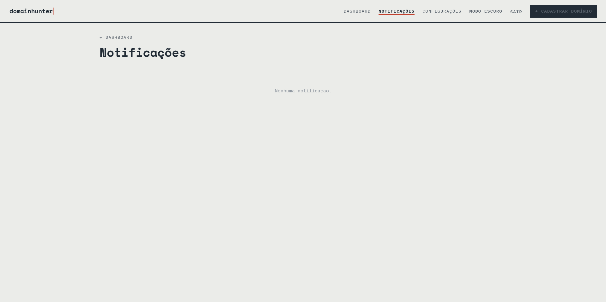
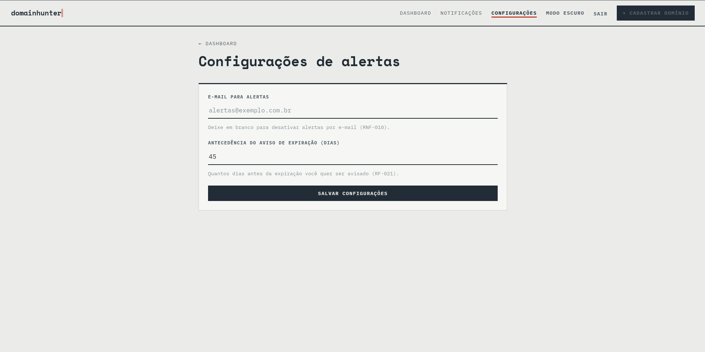

# DomainHunter

Aplicação para acompanhar domínios `.br`. O painel permite cadastrar domínios, consultar o estado observado, ver o histórico de eventos, solicitar uma verificação, pausar o acompanhamento e configurar notificações.

O cadastro consulta WHOIS, RDAP e ISAVAIL do Registro.br. A disponibilidade só é confirmada por uma resposta válida do ISAVAIL. Erros de consulta preservam o último estado confirmado.

## Capturas de tela

### Painel em modo claro



### Painel em modo escuro



### Cadastro de domínio



### Notificações



### Configurações de alertas



## Estrutura

| Diretório | Responsabilidade |
| --- | --- |
| `apps/web` | Painel web com autenticação por senha e páginas renderizadas no servidor |
| `apps/server` | API HTTP para domínios, eventos, notificações e configurações |
| `apps/automations` | Worker de tarefas agendadas e envio de e-mails |
| `packages/domain-core` | Regras de estado, eventos e persistência SQLite |
| `packages/providers` | Clientes WHOIS, RDAP, ISAVAIL e listas de liberação |
| `packages/notifications` | Criação e entrega de notificações |

O servidor e o worker compartilham o mesmo banco SQLite. Por padrão, o arquivo fica em `data/domainhunter.sqlite` e é criado automaticamente. O diretório `data/` não é versionado.

## Requisitos

- Node.js 24 ou superior
- pnpm 9 ou superior

## Executar localmente

```bash
pnpm install
pnpm dev
```

O painel abre em <http://127.0.0.1:8080> e a API em <http://127.0.0.1:3000>. O worker roda em paralelo. Para iniciar um processo por terminal:

```bash
pnpm --filter @domainhunter/server dev
pnpm --filter @domainhunter/web dev
pnpm --filter @domainhunter/automations dev
```

**Nenhuma variável de ambiente é obrigatória para testar localmente.** Sem `DOMAINHUNTER_PASSWORD`, o painel usa a senha padrão `domainhunter`; defina uma senha própria antes de permitir acesso de outras pessoas. A API não possui autenticação própria; mantenha-a acessível apenas na rede interna ou no endereço local.

## Configuração

O arquivo [`.env.example`](./.env.example) lista as variáveis disponíveis. Para usar uma variável na execução local com `pnpm dev`, exporte-a no terminal antes de iniciar os processos; o `pnpm` não carrega `.env` automaticamente.

| Cenário | Variáveis necessárias |
| --- | --- |
| Teste local com valores padrão | Nenhuma |
| Painel com senha própria | `DOMAINHUNTER_PASSWORD` |
| Docker Compose | `DOMAINHUNTER_PASSWORD` (obrigatória; o Compose recusa iniciar sem ela) |
| Alertas por e-mail | `DOMAINHUNTER_NOTIFICATION_EMAIL_TO`, `DOMAINHUNTER_SMTP_HOST` e `DOMAINHUNTER_SMTP_FROM`; usuário e senha se exigidos pelo servidor SMTP |

O servidor e o worker usam o mesmo caminho padrão para o banco local. No Docker Compose, o caminho compartilhado já está configurado. Assim, `DOMAINHUNTER_DB_PATH` só precisa ser definido se você escolher outro local de armazenamento.

| Variável | Uso |
| --- | --- |
| `DOMAINHUNTER_PASSWORD` | Senha do painel; obrigatória no Docker Compose; a sessão expira em 12 horas |
| `DOMAINHUNTER_DB_PATH` | Caminho do banco SQLite compartilhado pelo servidor e worker |
| `DOMAINHUNTER_API_URL` | Endereço da API usado pelo painel; padrão `http://127.0.0.1:3000` |
| `HOST` e `PORT` | Endereço e porta de escuta de cada processo |
| `DOMAINHUNTER_POLL_MS` | Intervalo de consulta da fila pelo worker; padrão 5000 ms |
| `DOMAINHUNTER_NOTIFICATION_EMAIL_TO` | Destinatário dos alertas por e-mail |
| `DOMAINHUNTER_SMTP_*` | Configuração SMTP para envio por e-mail; sem host, os alertas ficam apenas no painel |
| `WEB_PORT` | Porta local publicada pelo Docker Compose; padrão 6645 |
| `REGISTRO_BR_URL` | Endereço do Registro.br usado pelo painel |

O painel armazena um e-mail de alerta e a antecedência de aviso de expiração. O envio pelo worker depende da configuração SMTP e de `DOMAINHUNTER_NOTIFICATION_EMAIL_TO` no ambiente.

## Publicar com Docker Compose

```bash
cp .env.example .env
# No arquivo .env, descomente DOMAINHUNTER_PASSWORD e escolha uma senha forte.
docker compose up -d --build
```

O Compose inicia painel, API e worker. O painel é publicado somente em `127.0.0.1:6645` por padrão; altere `WEB_PORT` se necessário. Para acesso externo, configure um proxy reverso com HTTPS apontando para essa porta. A API fica na rede interna do Compose. O volume `domainhunter-data` conserva o banco entre reinicializações.

## Verificação

```bash
bash scripts/verify.sh
```

O script instala dependências com o lockfile, verifica os tipos em todos os pacotes e executa os testes. A integração contínua roda o mesmo comando em pushes e pull requests.

## API

| Método e rota | Função |
| --- | --- |
| `GET /health` | Estado do servidor |
| `POST /domains` | Cadastra um domínio `.br` e executa a consulta inicial |
| `GET /domains` | Lista domínios acompanhados |
| `GET /domains/:id` | Consulta um domínio |
| `GET /domains/:id/timeline` | Lista seus eventos |
| `POST /domains/:id/check` | Enfileira uma consulta manual |
| `PATCH /domains/:id` | Pausa ou retoma o acompanhamento |
| `DELETE /domains/:id` | Remove o acompanhamento |
| `GET /notifications` | Lista notificações do painel |
| `GET /settings` | Consulta as configurações de notificação |
